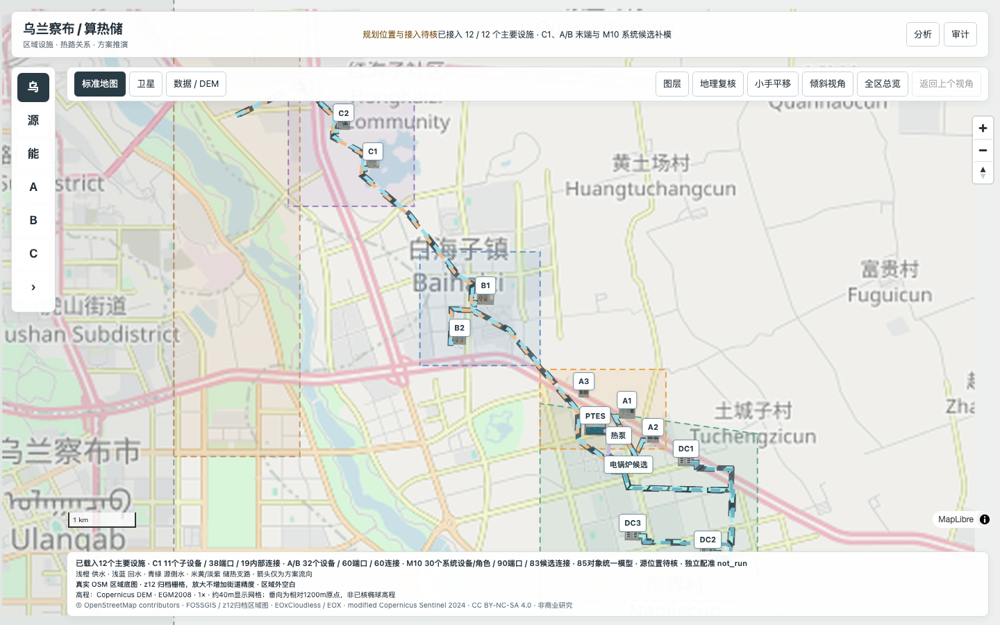

# 乌兰察布区域能源三维地图工作台

将数据中心余热、热泵、储热和农业用能设施放到同一张可交互的三维地图中，帮助方案讨论者看清**设备在哪里、热量如何传递、各区域做什么、哪些信息尚待核实**。

当前版本：**v0.3.0-rc.4 · 候选方案演示版**（2026-11-18）。主要入口是 `web/map-prototype/`，采用 MapLibre GL JS + Three.js，模型由 Blender 制作并导出为 GLB。



## 项目背景与解决的问题

区域算热储方案同时涉及地理位置、三维设备、供回水关系和分析数据。只看 PPT、平面图或独立模型，很难判断某个设施属于哪个区域、管线连接谁、选中的设备有什么属性，以及图上结论来自真实数据还是方案假设。

本项目把这些内容用统一实体 ID 关联起来：从地图或左侧索引选中设施，聚焦对应三维模型，查看同版模型图、用途、规划属性和候选连接，再进入地理复核或分析。它用于方案表达、关系梳理和发现证据缺口。

## 已有功能

| 板块 | 当前能力 |
| --- | --- |
| 地图与地形 | 标准地图默认显示，可切换卫星、数据 / DEM；保留当前视角与选择；展示真实 DEM 高程 |
| 三维设施 | 85 个可选实体、12 个主要设施、6 个示意区域；每个可选实体都有网格 |
| 能源关系 | 数据中心、热泵枢纽、PTES 储热、农业末端和候选电锅炉；188 个模型端口、162 条可见候选连接、22 条外部候选路线 |
| 地图操作 | 平移、缩放、倾斜、全区总览与返回上个视角；图层可开关 |
| 实体索引 | 默认图标栏；展开后支持树状分组、搜索和拖宽；与地图共用同一实体 ID |
| 设备详情 | 点击高亮、相机聚焦、同版图片、属性、关系及缺口；子设备可返回父设施 |
| 地理复核 | 2,814 个公开地物、293 条筛查观察；搜索、分类过滤、定位、高亮及来源哈希 |
| 决策分析 | 按对象、工况和时段展示；目前仅 C1 有合成教学数据，其余设施显示无数据 |
| 审计 | 查看模型、路线、注册表与分析来源；可导出审计 JSON |

### 区域与业务设施

| 区域 | 展示内容 |
| --- | --- |
| A1 | 种薯组培相关设施、温室与供热末端 |
| A2 | 食用菌设施与空气处理设备 |
| B1 | 番茄温室与配套设备 |
| B2 | 草莓温室与配套设备 |
| C1 | 叶菜水培 / 冷凉种苗，热水、营养液和控制关系分开表达 |
| C2 | 换热与提温候选方案，三换热器及配套控制、电输入 |

四个农业测点已经有实体仪表网格和独立图卡，当前状态为**未接管示意样件**；没有厂家、量程、PLC 接线或实时读数。CO₂ 循环保持在热泵站内，与用户供暖水、营养液和电输入分开。

## 快速启动

### 方式一：克隆代码

需要 **Python 3.10+、现代桌面浏览器（支持 WebGL）和网络**。查看演示不需要安装 Blender、Node.js 或 MCP，也不需要 Google API key。

```sh
git clone https://github.com/CarliYz/wulanchabu-energy-map.git
cd wulanchabu-energy-map
python3 launch.py
```

启动器会选择空闲的本机端口、打印地址并打开浏览器。关闭服务时在终端按 `Ctrl+C`。Windows 可将 `python3` 换成 `py -3`。

macOS 也可双击根目录的 `打开三维系统.command`；若下载后未保留执行权限，可先运行：

```sh
chmod +x 打开三维系统.command
```

### 方式二：固定开发端口

在仓库根目录执行：

```sh
python3 web/map-prototype/serve.py
```

浏览器打开 `http://127.0.0.1:8767/web/map-prototype/`。端口已占用时优先使用 `launch.py`，避免关闭其他运行中的服务。

也可以从仓库根目录运行 `python3 -m http.server 8080 --bind 127.0.0.1`，访问 `http://127.0.0.1:8080/web/map-prototype/`。**不要直接双击 index.html 以 file:// 方式打开**，模型和 JSON 需要通过 HTTP 读取。

### 方式三：单文件 HTML

GitHub Release 附件提供可以直接双击的单文件 HTML。它内嵌当前演示所需的数据、GLB、地图资源和设施图片；浏览器仍需联网加载固定版本的 Three.js 与 MapLibre CDN。开发者也可以在仓库根目录执行：

```sh
python3 scripts/build_single_file_html.py
```

生成文件位于 `outputs/releases/energy-map-workbench-single-v0.3.0-rc.4.html`，GitHub Release 使用相同名称。单文件适合快速查看和演示，完整本地 HTTP 包适合稳定运行与调试。

### 下载 ZIP

GitHub 页面的 **Code → Download ZIP** 可下载代码与已提交的地图、模型资源；解压后进入目录，执行 `python3 launch.py`。发行版附件提供相同版本的启动包与 SHA-256 校验文件。

Three.js 0.180.0 与 MapLibre GL JS 5.6.1 从固定版本 CDN 加载，运行时需要能访问 `cdn.jsdelivr.net`。当前不是完全离线包。

## 操作说明

1. **浏览区域**：默认标准地图；拖动平移、滚轮缩放，顶部切换卫星或数据 / DEM。
2. **展开索引**：点击左侧 `›`，按区域展开或搜索；点击 `‹` 收回，拖动边缘调整宽度。
3. **查看设施**：点击地图标签、三维模型或索引项目，模型会高亮并聚焦，右侧出现同 ID 详情卡。
4. **查看设备关系**：在设施卡进入设备 / 回路或候选连接，查看热水、营养液、控制、电输入等关系；点击相关对象定位，点击管段高亮。
5. **逐层退出**：子设备的关闭 / `Esc` 先返回父设施，再次关闭退出；地理复核详情先返回列表，再退出并恢复原上下文。各浮层也有关闭按钮。
6. **纯地图操作**：点“小手平移”暂停拾取，`Esc` 返回自由操作；“全区总览”复位，“返回上个视角”恢复上一视角。
7. **查看地理观察**：顶部“地理复核”打开列表，搜索对象或路线，按地物类型筛选，点击观察定位。
8. **查看分析**：选中 C1（`AGRI_018`）后打开“分析”，切换工况和时段；其他对象当前显示缺输入，不会套用 C1 的数据。
9. **核对来源**：打开“审计”，检查版本和来源，必要时导出 JSON。

建议演示顺序：全区总览 → A1 / A2 / B1 / B2 → `AGRI_014_SENSOR` 等测点 → C1 双回路 → 热泵 / PTES → 地理复核 → C1 分析。

## 地图和模型来源

- **标准地图**：OpenStreetMap / FOSSGIS 署名区域归档图；白底道路地图不是 Google Maps。归档范围有限，放大不会增加原始精度。
- **卫星图**：EOxCloudless Sentinel-2 2024，使用 CC BY-NC-SA 4.0 条款；保留署名和非商业 / 相同方式共享要求。
- **地形**：Copernicus DEM GLO-30，使用 EGM2008 正高，模型高程倍率为 1。
- **坐标**：EPSG:32649，Blender Z-up → GLB / 地图的转换见 `data/contracts/coordinate-contract.json`。
- **设施**：程序化 Blender 方案模型；当前总设施资产为 `web/map-viewer/assets/integrated-v3/facilities.glb`。

第三方数据和软件的权利说明见 [THIRD_PARTY_NOTICES](THIRD_PARTY_NOTICES.md)。公开可见不等于为全部代码、地图或素材授予统一开源许可；本次未添加 MIT 等软件许可证。Google API 尚未接入。

## 开发与验证

Node.js 22+ 用于原生 Node 单元测试；Python 合同测试额外需要 jsonschema。浏览演示不需要下列安装步骤。

```sh
node --test tests/*.test.mjs
python3 -m venv .venv-contracts
.venv-contracts/bin/python -m pip install jsonschema==4.23.0
.venv-contracts/bin/python -m unittest discover -s tests -p 'test_*.py'
python3 scripts/validate_integrated_model.py --output qc/public-model-validation.json
python3 scripts/verify_public_release.py
```

Windows 使用 `.venv-contracts/Scripts/python`。`requirements-contracts.txt` 记录制作环境的完整依赖版本；上方命令给出测试所需的直接依赖。

更广交互回归采用 `qa/agent-e2e/` 的 e2e 与既有 Playwright，需安装对应依赖和浏览器，见 [QA 说明](qa/agent-e2e/README.md)。根目录 `npm run qa` 指向旧版 viewer，不能当作当前工作台的整站验收。Jev 视觉调用需要另行配置环境凭据，当前不宣称已验证。

Blender 建模 / 导出脚本保存在 `src/map_v2/`。网页可直接加载仓库中的 GLB；重建原生模型还需准备原始方案、DEM 和已保存场景，并调整脚本中的本地 BASE 路径。原始资料和 `.blend` 未放入公共仓库，本次不宣称从空目录一键重建全部 Blender 工程。

## 目录

```text
web/map-prototype/        当前工作台：地图、选择、详情、关系、分析、审计
web/map-viewer/           历史查看器与模型 / 预览资源；当前入口会复用其 assets
src/map_v2/               Blender 建模、导出、运行数据生成脚本
src/dispatch.py          合成教学场景的热量调度计算
data/                    坐标合同、设施路线和教学输入
qa/agent-e2e/             当前工作台交互测试、MCP 与可选 Jev 配置
tests/                   Node / Python 行为及数据合同测试
qc/                      必需的公开地理数据与发布验证记录
design/m7/map-assets/     三种地图设计底图与署名
docs/                    架构、发布范围和截图
launch.py                使用空闲端口的本机启动器
```

## 版本与验收范围

当前版本为 **v0.3.0-rc.4**，基于 M14 模型、M15 设计同步、M16 网页交互收尾和 M17 响应式/索引复核修订，并补充可直接双击的单文件 HTML 发布路径。版本变化见 [CHANGELOG](CHANGELOG.md)，公共快照的来源和排除范围见 [发布说明](docs/PUBLIC_RELEASE.md)。

原 M14 已有分组 96 种交互行为证据、三尺寸路线 66/66、Node 38/38、Python 35/35；这些是当时受测身份下的结果，不等于本次重新执行完整 96 项。M15 完成 39 个设计状态和 4 个浮层，并实点 8 条代表性 Figma 路径；不代表全部页面或独立 QA 已通过。当前公共快照的文件身份以 `public-release-manifest.json` 为准；本地启动和验收边界见 `RELEASE.md`。

当前测试入口为 `npm run qa:current`；完整依赖安装、隔离服务与回执说明见 [当前QA说明](docs/QA_CURRENT.md)。根目录 `npm run qa` 保留历史viewer配置。CI包含合同、来源SHA和当前网页交互；配置不代表运行通过，结果以Actions实际回执为准。

rc.4 标签提交 `0a8d466` 的 [合并后 CI](https://github.com/CarliYz/wulanchabu-energy-map/actions/runs/44291011783) 已完成：Node 38/38、Python 35/35、完整 e2e **122/122 通过**（10 个测试文件，0 失败，0 跳过），发布快照与模型校验通过。公开单文件另已通过 `file://` 初始化、三底图、索引和 Escape 冒烟检查。实际回执和下载文件校验见 [rc.4 Release](https://github.com/CarliYz/wulanchabu-energy-map/releases/tag/v0.3.0-rc.4) 的 `release-verification.json` 和 `SHA256SUMS.txt`；Release 附件对应标签快照，main 后续文档更新不改写该快照。合同测试按 `requirements-contracts.txt` 安装依赖后执行。

## 当前边界与后续

这是**候选方案和数据关系演示**。模型端口、可见管线和地图上的位置不代表工程已批准、已施工或已投运。

- C1 场坪与 P2 回水候选线和公开红海子水体几何相交，观察保留；需要独立控制点、岸线 / 地籍及坐标高程核验。
- 22 条外部路线是候选走廊，尚未完成路网、穿越、权属、许可、水力和热力设计。
- 仪表尚无真实接管和 PLC 数据；实际负荷、流量、温度、泵曲线与时序输入待接入。
- 分析仅 C1 使用合成教学结果；没有实时监测、生产控制或真实节能收益结论。
- 网页三尺寸交互纳入当前自动回归；Figma更多路径/响应式、独立联合 QA、Google / Jev 实调用和生产部署回滚仍待完成。
