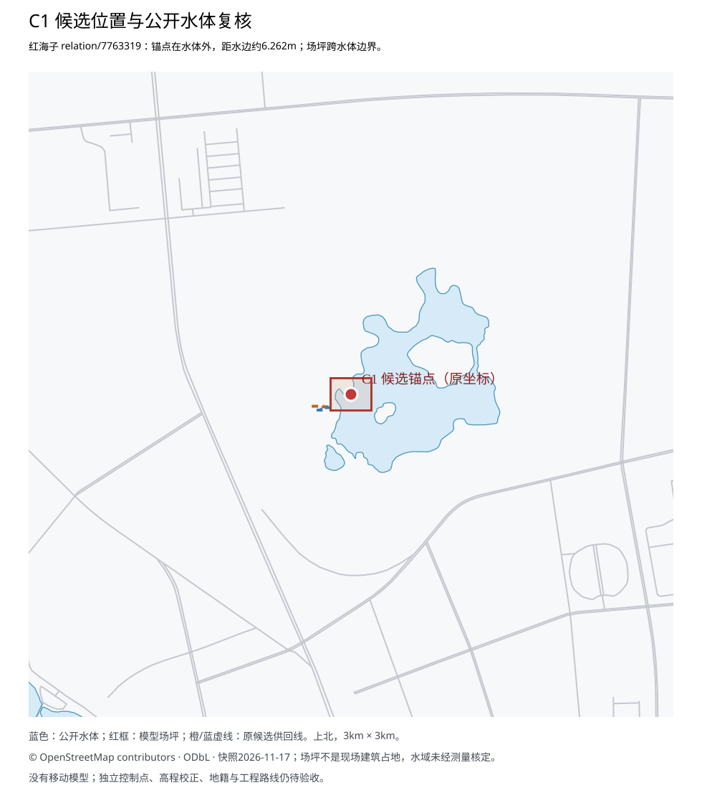

# 公开地物与候选位置复核

2026-11-17。四类原始快照2814个要素，22候选路线与12主设施全部复跑。水体28个（含3个多边形关系）完整保留；outer/inner、包含、岛屿与缺损几何分别处理。

## 关键发现

C1原锚点位于公开红海子水体外，距边界约6.262m；当前GLB的实际场坪顶点凸包与该公开水体相交。P2_V2_RETURN也与红海子公开几何相交，P2_V2_SUPPLY距最近水体约7.519m。没有修改模型或22条路线。

旧M11筛查在relation无顶层geometry时提前跳过，漏读3关系；也未处理整段位于水面内部的情形。旧25/28红回归保留，当前28/28。此报告取代旧水域筛查结论；不同投影算法产生小幅筛查距离差异，不作为测量精度。

## 候选路线观察

距离为近似米制筛查；0m表示公开几何相交/面内，30m仅为复核阈值。每格最多列3项，完整ID、标签、最近坐标、SHA见geographic-review.json。

| 路线 | 道路 | 铁路 | 线状水域 | 水体面 |
|---|---|---|---|---|
| P2_V2_SUPPLY | 未命名 way/1050501884 / 0m；未命名 way/1050501894 / 0m；未命名 way/260494782 / 0m；另31项 | 本快照30m内未发现 | 本快照30m内未发现 | 未命名 way/543066663 / 7.519m；红海子 relation/7763319 / 17.635m |
| P2_V2_RETURN | 未命名 way/1050501884 / 0m；未命名 way/1050501894 / 0m；未命名 way/260494782 / 0m；另32项 | 本快照30m内未发现 | 本快照30m内未发现 | 红海子 relation/7763319 / 0m；未命名 way/543066663 / 25.13m |
| AGRI_014_SUPPLY | 未命名 way/1050501894 / 0m；G110 way/444203184 / 0m；G110 way/48908131 / 0m；另3项 | 本快照30m内未发现 | 本快照30m内未发现 | 本快照30m内未发现 |
| AGRI_014_RETURN | 未命名 way/1050501894 / 0m；G110 way/444203184 / 0m；G110 way/48908131 / 0m；另3项 | 本快照30m内未发现 | 本快照30m内未发现 | 本快照30m内未发现 |
| AGRI_015_SUPPLY | 未命名 way/1050501894 / 0m；未命名 way/542682425 / 0m；未命名 way/542682426 / 0m | 本快照30m内未发现 | 本快照30m内未发现 | 本快照30m内未发现 |
| AGRI_015_RETURN | 未命名 way/1050501894 / 0m；未命名 way/542682425 / 0m；未命名 way/542682426 / 0m | 本快照30m内未发现 | 本快照30m内未发现 | 本快照30m内未发现 |
| AGRI_016_SUPPLY | 未命名 way/543567188 / 1.146m；未命名 way/543567186 / 23.998m | 本快照30m内未发现 | 本快照30m内未发现 | 本快照30m内未发现 |
| AGRI_016_RETURN | 未命名 way/543567186 / 27.998m；未命名 way/543567188 / 29.356m | 本快照30m内未发现 | 本快照30m内未发现 | 本快照30m内未发现 |
| AGRI_017_SUPPLY | 未命名 way/444203205 / 0m；未命名 way/542682419 / 0m；未命名 way/542682420 / 0m | 本快照30m内未发现 | 本快照30m内未发现 | 本快照30m内未发现 |
| AGRI_017_RETURN | 未命名 way/444203205 / 0m；未命名 way/542682419 / 0m；未命名 way/542682420 / 0m；另1项 | 本快照30m内未发现 | 本快照30m内未发现 | 本快照30m内未发现 |
| AGRI_018_SUPPLY | 本快照30m内未发现 | 本快照30m内未发现 | 本快照30m内未发现 | 本快照30m内未发现 |
| AGRI_018_RETURN | 本快照30m内未发现 | 本快照30m内未发现 | 本快照30m内未发现 | 本快照30m内未发现 |
| DRY_019_SUPPLY | 本快照30m内未发现 | 本快照30m内未发现 | 本快照30m内未发现 | 本快照30m内未发现 |
| DRY_019_RETURN | 本快照30m内未发现 | 本快照30m内未发现 | 本快照30m内未发现 | 本快照30m内未发现 |
| DC_004_SOURCE | 未命名 way/1050501894 / 0m；G110 way/444203184 / 0m；G110 way/48908131 / 0m；另6项 | 本快照30m内未发现 | 本快照30m内未发现 | 本快照30m内未发现 |
| DC_004_SOURCE_RETURN | 未命名 way/1050501894 / 0m；G110 way/444203184 / 0m；G110 way/48908131 / 0m；另6项 | 本快照30m内未发现 | 本快照30m内未发现 | 本快照30m内未发现 |
| DC_005_SOURCE | 未命名 way/1050501894 / 0m；未命名 way/1050501895 / 0m；未命名 way/542682414 / 0m；另7项 | 本快照30m内未发现 | 本快照30m内未发现 | 本快照30m内未发现 |
| DC_005_SOURCE_RETURN | 未命名 way/1050501894 / 0m；未命名 way/436803949 / 0m；未命名 way/542682414 / 0m；另7项 | 本快照30m内未发现 | 本快照30m内未发现 | 本快照30m内未发现 |
| DC_006_SOURCE | 未命名 way/1050501894 / 0m；未命名 way/1050501895 / 0m；未命名 way/542682414 / 0m；另6项 | 本快照30m内未发现 | 本快照30m内未发现 | 本快照30m内未发现 |
| DC_006_SOURCE_RETURN | 未命名 way/1050501894 / 0m；未命名 way/1050501895 / 0m；未命名 way/542682414 / 0m；另6项 | 本快照30m内未发现 | 本快照30m内未发现 | 本快照30m内未发现 |
| PTES_CHARGE | 未命名 way/1050501894 / 0m；未命名 way/542682427 / 0m | 本快照30m内未发现 | 本快照30m内未发现 | 本快照30m内未发现 |
| PTES_RETURN | 未命名 way/1050501894 / 0m；未命名 way/542682427 / 0m | 本快照30m内未发现 | 本快照30m内未发现 | 本快照30m内未发现 |

## 主设施锚点与实际模型场坪

| 主设施 | 锚点至最近水边 | 模型场坪观察 | 最近水体 |
|---|---|---|---|
| DC_004 华为云数据中心 | 2551.863m | 30m内未发现/邻近，见JSON | 白海子 way/543802938 |
| DC_005 阿里巴巴数据中心 | 2422.163m | 30m内未发现/邻近，见JSON | 未命名 way/444203660 |
| DC_006 益武堂数据中心组团 | 1932.042m | 30m内未发现/邻近，见JSON | 未命名 way/444203660 |
| HUB_011 CO₂跨临界热泵枢纽 | 1626.212m | 30m内未发现/邻近，见JSON | 白海子 way/543802938 |
| STORE_012 PTES池式储热 | 1195.857m | 30m内未发现/邻近，见JSON | 白海子 way/543802938 |
| DEMO_013 独立CO₂冷热与土壤储热科研 | 1088.881m | 30m内未发现/邻近，见JSON | 白海子 way/543802938 |
| AGRI_014 种薯组培与原原种温室 | 1672.788m | 30m内未发现/邻近，见JSON | 白海子 way/543802938 |
| AGRI_015 工厂化食用菌 | 2039.598m | 30m内未发现/邻近，见JSON | 白海子 way/543802938 |
| AGRI_016 冬季番茄连栋温室 | 1693.607m | 30m内未发现/邻近，见JSON | 白海子 way/543802938 |
| AGRI_017 冬春草莓高架温室 | 1209.126m | 30m内未发现/邻近，见JSON | 白海子 way/543802938 |
| AGRI_018 叶菜水培与冷凉种苗 | 6.262m | 与公开水体相交/包含 | 红海子 relation/7763319 |
| DRY_019 秋季低温烘干中心 | 532.027m | 30m内未发现/邻近，见JSON | 红海子 relation/7763319 |

## 判决与下一门

Standards：原始快照SHA、要素计数、GLB实际顶点身份与失败路径通过本批检查。Spec：公开筛查数据和复核图完成；主页面覆盖层/逐条定位沿用M13已实现功能，本批更新M14模型身份；当前浏览器整合验收另见本批acceptance-summary.json，独立地理与工程验收仍blocked/not_run。审查模式coordinator_single_agent。

锚点、场坪、现场建筑占地分别看待；本图不是现场岸线、地籍、用地许可或施工断面。水体孔洞被排除，未命中仍不证明不存在。独立控制点、测量容差、高程校正、工程路由与水力保持开放。当前观察已接入主地图；下一步按docs/NEXT_STEPS_20261117.md依据专业输入决定路线调整。

路线SHA256：b1f5544c37c4b574913a6fed18709b9382dbc98ddb0acfb6c5112d53c22fba83。模型SHA256：aa00fa4c3502197f77851c3a2eb6617875462862c0bbd7351ceeaf4c0cf1869f。来源及时间戳在geographic-review.json/source，全部公开要素几何在public-features.geojson。© OpenStreetMap contributors · ODbL。
